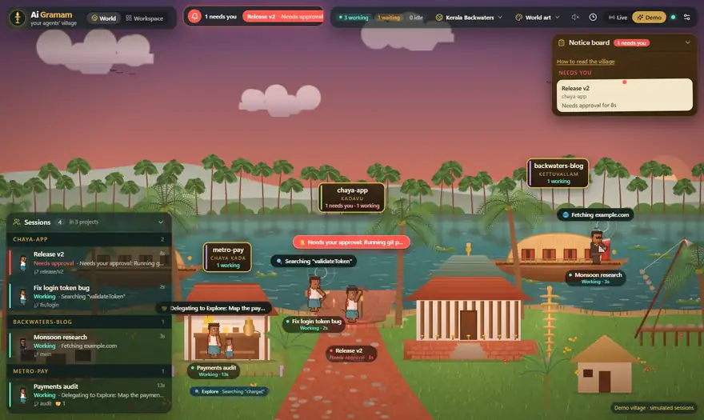
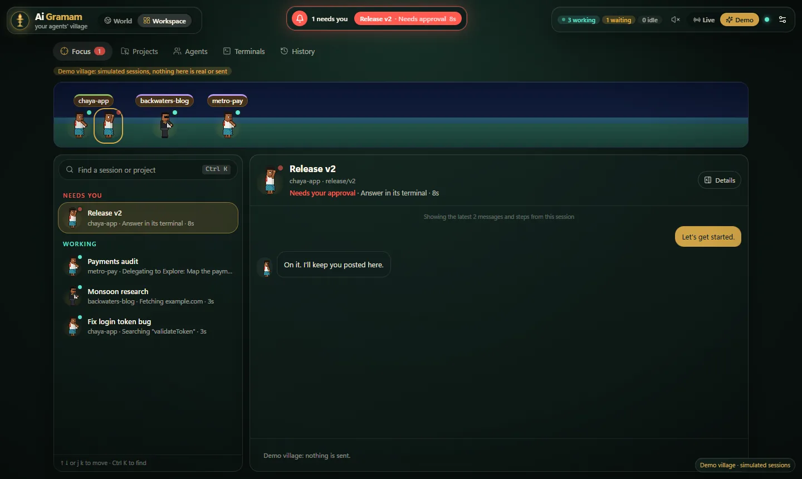
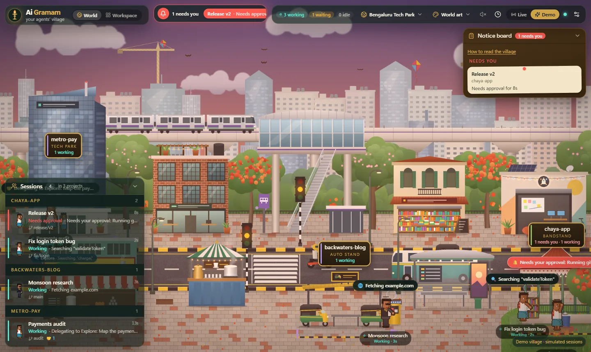
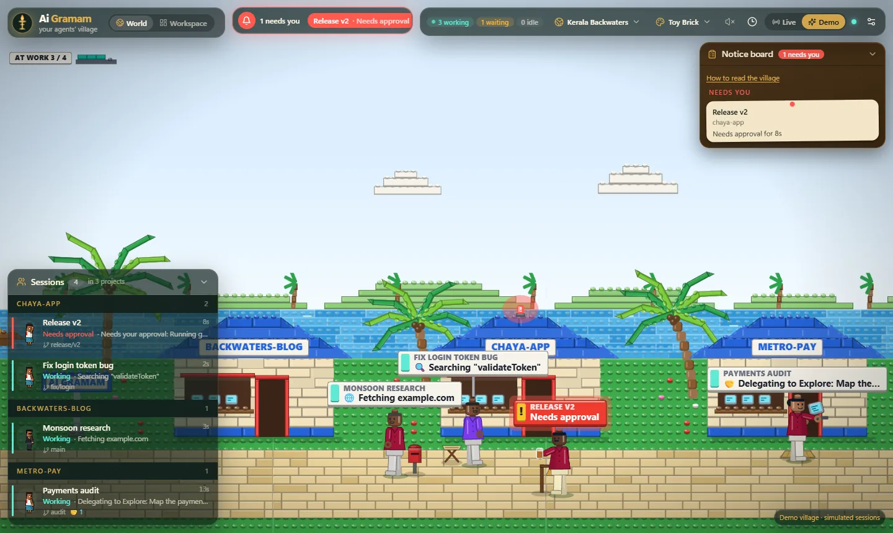
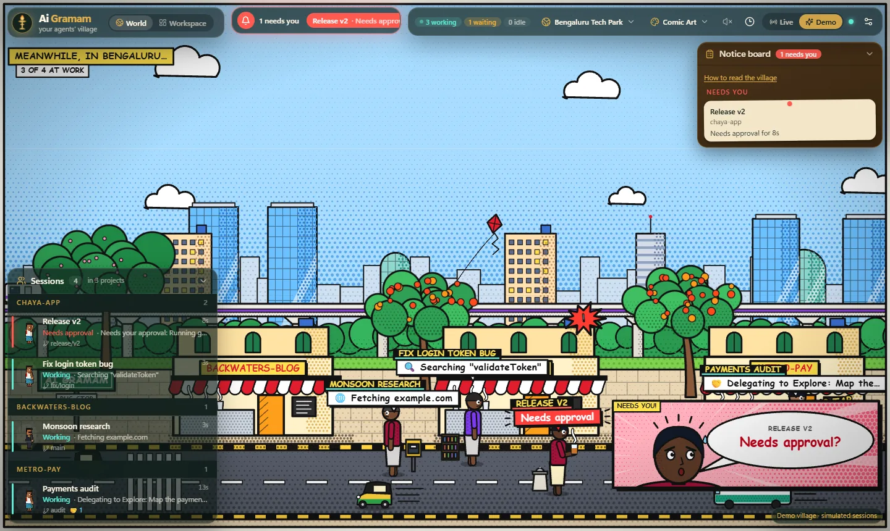

# Ai Gramam

[](https://github.com/Aswin1819/aigramam/actions/workflows/ci.yml)
[](https://github.com/Aswin1819/aigramam/releases)
[](LICENSE)

**Your Claude Code agents, living in a village.** Ai Gramam is a local browser app that turns every running Claude Code session into a villager in an animated Indian world, so you can tell at a glance which project, session and subagent is doing what, and when one of them needs you.



| Workspace → Focus | Bengaluru Tech Park |
|---|---|
|  |  |
| **Toy Brick art style** | **Comic Art style** |
|  |  |

<sub>All screenshots use the built-in demo (simulated sessions).</sub>

- **Projects are places.** Each project gets a location (a houseboat, the chaya kada, the temple…) and its own yard, with its name and counts on a signboard in the project's colour. It keeps its place while the page is open.
- **Sessions are villagers.** Each session stands at the station for what it's doing (study for reading, desk for writing, works for commands and tests, gate for the web, porch when it needs you, bench when it's your turn), with a label showing the live action: `✏️ Editing auth.ts`, `🧪 Running tests`, `🔍 Searching "login"`. Villagers walk only when their work changes, and one lamp per session shows its state.
- **Subagents are companions** that walk in beside their parent while they work and leave when they finish.
- **Waiting for you is impossible to miss.** Approvals and questions ring a bell in the top bar, glow red in the world and pop a toast. "Your turn" glows amber.
- **A living world.** Real day and night that follow your clock, monsoon rain with lightning, swaying palms, drifting clouds, bobbing houseboats, a canoe, ducks, fireflies, and a row of nilavilakku lamps lighting up when a task finishes.
- **Worlds and characters are data packs.** Upload a `.zip` in Settings, or drop a folder in, and it appears within seconds, no restart. Every pack shows its author and license.
- **Your cast.** Choose the character each project's sessions appear as (drawer → Details → Character).
- **Art styles.** Besides the Kerala world, draw the village as PS2, Comic Art, Flat Vector, CGI Motion, Toy Brick or Explainer 3D (world menu in the top bar). Compare all ten prototypes in the Style lab at `/styles`.
- **Workspace → Focus:** a queue of every session, what needs you first, with the chosen session's conversation beside it: reply, stop, approve or answer without leaving the page (↑ ↓ or j k to move, Ctrl+K to find). Also Projects (with Git state), Agents, Terminals and History.
- **Sound cues** when a session needs you or it's your turn (mute in the top bar).

Everything runs on your machine: the server listens on `127.0.0.1` only, makes no outside network calls, and never writes your transcripts anywhere.

## Two parts

- **The app** (this repository): a local web app you start and open at http://localhost:4317. It shows the village, Workspace Mode, terminals and history, and works on its own by reading Claude Code's files.
- **The mod** (`plugin/ai-gramam`, optional): a Claude Code plugin that links each session to the app so you can message, stop, approve and answer it from the browser.

Installing the mod doesn't install or start the app. Full steps, updates and removal: **[docs/INSTALL.md](docs/INSTALL.md)**.

## Quick start (Windows)

Requirements: Node.js 18+, Git and Claude Code.

**1. The app:**

```powershell
git clone https://github.com/Aswin1819/aigramam.git
cd aigramam
npx -y pnpm@10.4.1 install
npx pnpm@10.4.1 dev
```

**2. The mod** (optional: lets you talk to sessions from the browser), in a terminal, or inside Claude Code as `/plugin …`:

```powershell
claude plugin marketplace add Aswin1819/aigramam
claude plugin install ai-gramam@aigramam
```

Open **http://localhost:4317** (the port comes from `.env`; copy `.env.example` to change it). Start Claude Code in any folder and a villager walks in within a few seconds. No sessions yet? Click **Demo** in the top bar, or open http://localhost:4317/?demo. Something missing? **Settings → Session link** checks each part and says which one needs attention ([docs/TROUBLESHOOTING.md](docs/TROUBLESHOOTING.md)).

Tips: drag to pan, scroll to zoom, click a villager (or a row in the dock) to open its details, <kbd>Esc</kbd> to step back. Try `?time=night` to preview the night.

## Talk to your sessions (the Ai Gramam mod)

Install the mod once and every new Claude Code session links itself to the village. Then, from a villager's drawer or Workspace → Focus, you can:

- **send a message**: it runs as your own prompt as soon as the session is free;
- **stop** what it's doing (like Esc in the terminal);
- **approve or deny permission requests**: requests that would have asked *you* come to the browser first (inline in the chat, in the top bar and as a toast). With no answer in 45 s, the normal prompt appears in the terminal;
- **answer Claude's questions** (multiple choice, several at once, or your own words) right in the chat. "Answer in terminal" or no answer in 45 s, and the normal dialog appears there.

Plan approvals are still answered in the terminal, and if another plugin answers permission requests before the mod, those stay in the terminal too. The mod sends only small details (paths, commands) to `127.0.0.1` with your local key.

```powershell
claude plugin marketplace add Aswin1819/aigramam
claude plugin install ai-gramam@aigramam
```

(Or `claude plugin marketplace add C:\path\to\aigramam` to install from your clone.)

Sessions that were already running link after a restart. **Settings → Session link** shows whether the mod is installed and up to date and how many sessions are linked, and each session's status line says `Ai Gramam ● linked` (or why it isn't). To update: `claude plugin marketplace update aigramam` then `claude plugin update ai-gramam@aigramam`. The mod's source is in `plugin/ai-gramam`.

## Terminals

**Workspace → Terminals** (or **Open terminal here** on a project) starts PowerShell in that project's folder, in the browser. It runs on this computer with your permissions, only when you click, and only in folders of projects Ai Gramam already shows; up to 8 at once. Closing a terminal stops its shell. Terminals you opened yourself aren't shown or controlled here.

## Exact approval alerts without the mod (optional)

From transcripts alone Ai Gramam can see questions and "your turn" exactly, but a **permission prompt** can only be guessed. **Settings → Alerts → Install hooks** adds Claude Code HTTP hooks to your user settings. It shows you the exact before/after first, saves a backup to `~/.ai-gramam/backups`, keeps your existing hooks, and can be undone. The hooks apply to every project, send events only to `127.0.0.1`, and never change what Claude does.

## Worlds and characters

| | Built in | Your own (hot reloaded) |
|---|---|---|
| Worlds | `worlds/<id>/world.json` + images | `~/.ai-gramam/worlds/<id>/` |
| Characters | `characters/<id>/pack.json` + `sprites.png` | `~/.ai-gramam/characters/<id>/` |

Shipped: **Kerala Backwaters** and **Bengaluru Tech Park** (metro, autos, darshini, filter kaapi, gulmohars and drizzle), plus three original characters: **Unni** (mundu hero), **Shades** (stylish villain) and **Chaya Kutty** (comic sidekick). All built-in art is original and CC0, generated in code by `node scripts/gen-art.mjs`; replace it with real pixel art any time. Install a pack by dropping its `.zip` in **Settings → Worlds** or **Settings → Characters**, or copy its folder into `~/.ai-gramam`. Packs are validated (paths, image sizes, sprite-sheet rows and frames), and a broken pack is listed in Settings with its errors and never breaks the app.

- [docs/WORLDS.md](docs/WORLDS.md): how to make a world (`world.json`, layers, locations, decor, lighting, weather).
- [docs/PACKS.md](docs/PACKS.md): how to make a character (`pack.json`, sprite sheet) and choose one per project.
- [docs/ART-STYLES.md](docs/ART-STYLES.md): the art styles, the Style lab and how to add a style.

## How it works

```
~/.claude/projects/**/*.jsonl  ┐
~/.claude/sessions/<pid>.json  ├─► monitor (server/monitor) ─► Project → Session → Subagent ─► WebSocket ─► world (Phaser) + UI (React)
Claude Code HTTP hooks (opt.)  ┘
```

- `server/monitor/`: reads the transcripts from the end, follows subagent files and the session registry, and accepts optional hook events.
- `server/worlds`, `server/characters`, `server/packs`: pack loading, validation and hot reload.
- `client/src/world/`: the Phaser scene (sky, lighting, weather, decor, characters, camera) and HTML labels.
- `client/src/app/`: the top bar, session dock, detail drawer and settings (React, Tailwind, Motion).

Tests: `npx pnpm@10.4.1 test` · Types: `npx pnpm@10.4.1 check` · Production: `npx pnpm@10.4.1 build` then `npx pnpm@10.4.1 start`.

## Remote bridge (optional)

To show sessions from another computer, run `bridge/ai-gramam-bridge.mjs` there. **Settings → Remote bridge** gives you the exact commands with your key.

## Known limitations

- Built and tested on Windows 11. Other systems are untested; terminals start `powershell.exe`.
- Without the mod, permission prompts can only be guessed from transcripts (install the mod, or the optional hooks, for exact alerts).
- Plan approvals, and permission requests another plugin answers first, stay in the terminal.
- History only reaches back as far as Claude Code keeps transcripts (30 days by default), and approvals aren't recorded in transcripts.
- Token counts are the API's own figures; Ai Gramam shows no costs.
- The mod is distributed from this repository's own marketplace, not Anthropic's plugin directory.

## Docs

[Install](docs/INSTALL.md) · [Troubleshooting](docs/TROUBLESHOOTING.md) · [Security and your data](SECURITY.md) · [Changelog](CHANGELOG.md) · [Worlds](docs/WORLDS.md) · [Characters](docs/PACKS.md) · [Art styles](docs/ART-STYLES.md)

## License

Released under the MIT license; see `LICENSE`.
